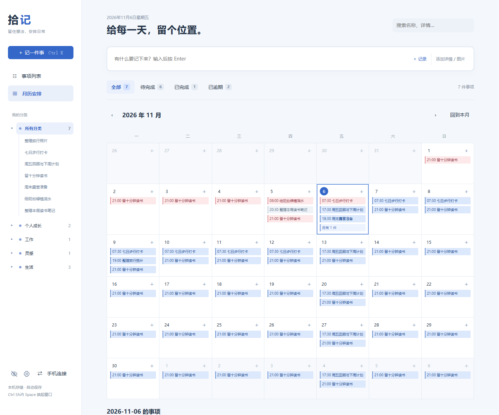

<div align="center">


# Shiji · 拾记

**Notes, screenshots, and tasks in one local calendar.**

[Download for Windows](https://github.com/zenghong128-ui/shiji/releases/latest) · [简体中文](README.md)

</div>



Shiji is a local-first desktop notes and task app, with a Chinese-language interface. Mix text and images, schedule recurring reminders, backfill past dates, and keep selected items hidden behind a password-controlled visibility switch.

## Highlights

- Quick capture, custom categories, search, completion counts, and a month calendar.
- Paste screenshots or insert images between paragraphs. Browse an item's images with previous/next, zoom, and original-size controls.
- One-time, daily, weekly, and date-range schedules, including optional recurrence end dates.
- Independent completion for each occurrence of a recurring task.
- Windows reminder dialogs, with separate start/end notifications for time ranges.
- Protected task names hidden by default; a password unlocks visibility for 15 minutes. Opening protected details requires a separate password check.
- Optional phone access over a trusted local network. Data remains on the computer.

## Start

**Windows x64:** download the ZIP from [Releases](https://github.com/zenghong128-ui/shiji/releases/latest), extract everything, and run `Shiji.exe`. No Python installation is needed. Run `Stop-Shiji.cmd` to stop its background process. The desktop window uses Microsoft Edge when available.

**Source:** Python 3.10+, with no third-party runtime dependencies.

```sh
git clone https://github.com/zenghong128-ui/shiji.git
cd shiji
python app.py
```

```sh
python app.py --no-window
python app.py --lan
python app.py --port 8770
python app.py --stop
```

The source can serve the browser UI on other operating systems, but native reminders and the global shortcut currently require Windows. Closing the window leaves reminders running. No startup entry is installed.

## Data and limitations

- Source data lives in `data/`; the Windows binary uses `%LOCALAPPDATA%\Shiji\`. Set `SHIJI_DATA` to choose another directory.
- Stop the backend before copying the complete data directory for backup.
- Passwords are salted PBKDF2 hashes; **the SQLite database and backups are not encrypted**. There is no password recovery.
- LAN access uses HTTP and a connection credential. Use a trusted network; do not expose the port to the internet.
- The computer must stay on for reminders and phone access. There is no cloud sync, mobile offline mode, or mobile background push.
- Visibility authorization expires after 15 minutes and closes protected editors; save your changes before expiration.

```sh
python -m unittest -v
```

[Development](docs/DEVELOPMENT.md) · [Contributing](CONTRIBUTING.md) · [Issues](https://github.com/zenghong128-ui/shiji/issues) · [MIT terms](LICENSE)
