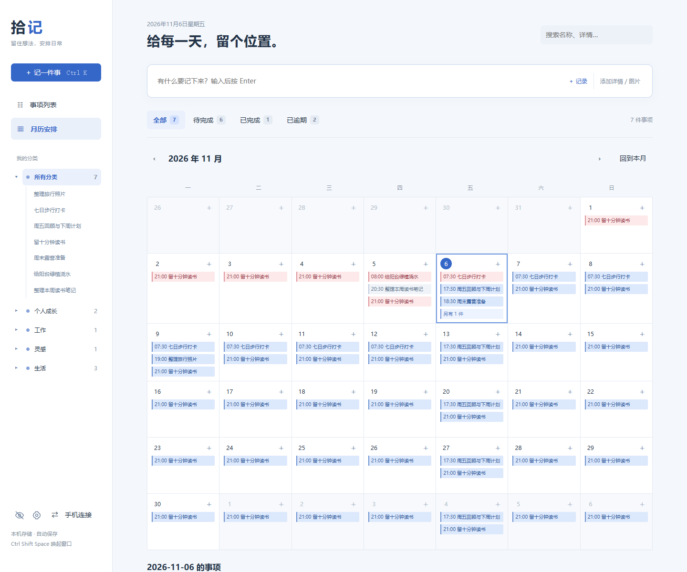
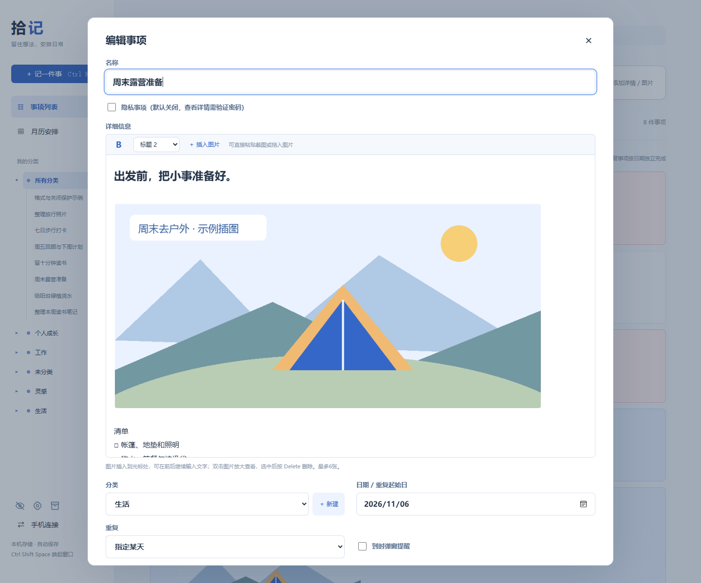
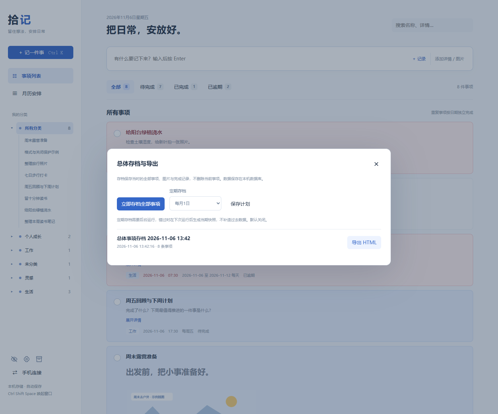
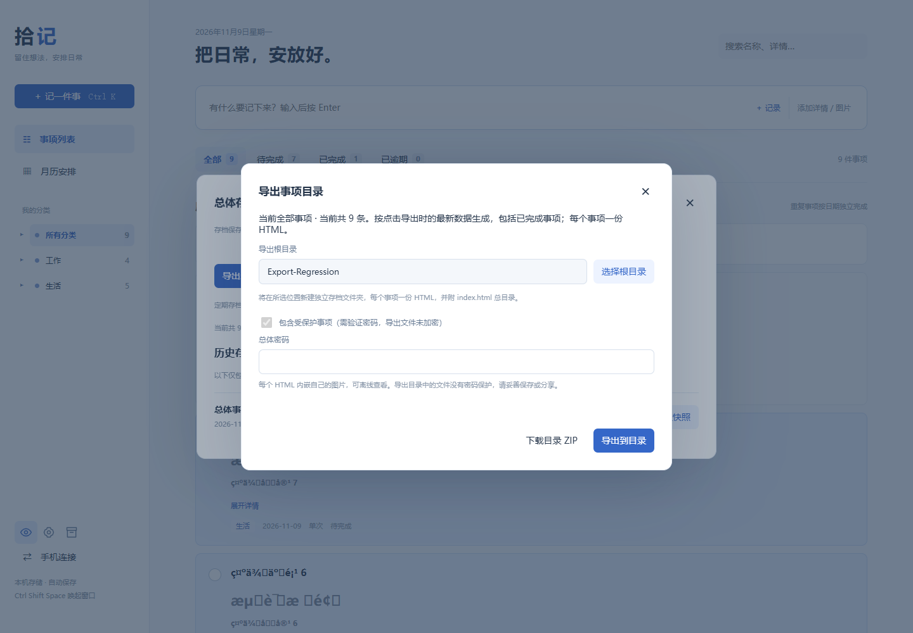
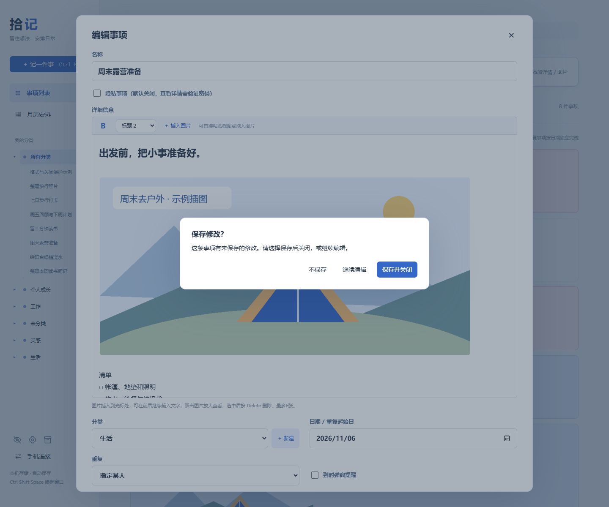

<div align="center">


# 拾记 Shiji

**把文字、截图和待办，放进同一份日历。**

一款本地优先的 Windows 桌面随手记工具：图文混排、重复提醒、月历补记，以及可自动锁定的受保护事项。

[](https://github.com/zenghong128-ui/shiji/releases/latest)
[](https://github.com/zenghong128-ui/shiji/actions/workflows/test.yml)
[](LICENSE)
[](https://www.python.org/)

[下载 Windows 版](https://github.com/zenghong128-ui/shiji/releases/latest) · [快速开始](#快速开始) · [使用指南](docs/USER_GUIDE.md) · [English](README.en.md)

</div>



## 适合记录什么

临时想法、带截图的工作笔记、会议资料、每天的小习惯、每周的检查清单，以及指定日期范围内的待办。既能随手记下，也能安排到某一天；过去的日期同样可以补记。

## 你可以用它做什么

| 能力       | 使用方式                                                   |
| ---------- | ---------------------------------------------------------- |
| 快速记录   | 输入名称后按 Enter 保存，`Ctrl + K` 打开完整编辑器         |
| 富文本编辑 | 选中文字加粗，支持正文与三级标题，格式会随图文一起保存     |
| 图文混排   | 在文字间插入图片，支持粘贴截图、拖放和文件选择             |
| 大图查看   | 双击图片放大，支持上一张／下一张、滚轮缩放、原图尺寸和拖动 |
| 灵活安排   | 单日、每天、每周多个星期，或起止日期范围；可设置重复截止日 |
| 到时提醒   | 设置具体时刻或时间段，开始与结束分别提醒                   |
| 完成与统计 | 按次完成重复事项，查看全部、待完成、已完成和逾期数量       |
| 月历补记   | 日期格点击「＋」或双击空白处，给过去或未来的一天添加记录   |
| 分类整理   | 下拉选择分类，展开侧栏分类查看事项，搜索名称和正文         |
| 受保护事项 | 名称默认隐藏，验证密码后显示 15 分钟；关闭后自动锁定       |
| 存档与导出 | 手动或每周／每月总体快照，导出内嵌图片的独立HTML           |
| 手机访问   | 同一可信 Wi-Fi 下访问电脑上的同一份数据，每 10 秒更新      |



## 快速开始

### Windows 下载版：无需安装 Python

1. 打开 **[最新版本下载页](https://github.com/zenghong128-ui/shiji/releases/latest)**。
2. 下载 `Shiji-v1.2.1-windows-x64.zip`，将整个压缩包解压到一个文件夹。
3. 双击 `Shiji.exe`，开始记录。推荐使用 Windows 10/11 与 Microsoft Edge。
4. 需要结束后台时，双击同目录的 `Stop-Shiji.cmd`。

关闭桌面窗口后，后台仍会运行并提醒；本版本不自动设置开机启动。

### 从源码运行

需要 Python 3.10 或以上。**应用运行只使用 Python 标准库，不需要安装第三方运行依赖。**

```powershell
git clone https://github.com/zenghong128-ui/shiji.git
cd shiji
python app.py
```

Windows 也可以双击 `启动拾记.cmd`。桌面窗口优先通过 Edge 的独立窗口模式打开，未找到 Edge 时使用默认浏览器。

```powershell
python app.py --no-window          # 仅启动后台
python app.py --lan                # 开启局域网访问，并打开窗口
python app.py --port 8770          # 使用其他端口
python app.py --stop               # 关闭本机后台（自定义端口时也传 --port）
```

macOS/Linux 可运行源码并用浏览器操作；当前系统提醒弹窗和全局唤起快捷键只实现了 Windows 版本。

## 日常操作

- `Ctrl + K`：打开记录编辑器。
- `Ctrl + Shift + Space`：后台运行时唤起桌面窗口，快捷键被占用时可能无法注册。
- 详细信息中 `Ctrl + V` 粘贴截图；每条最多 6 张图片，单张小于 2.8 MB。
- 双击正文图片进入查看器；`←` / `→` 换图，`Esc` 关闭。
- 月历中先选中日期，顶部快速输入也会使用该日期。
- 已完成使用浅色底，未完成使用蓝色底，已逾期使用浅红色底。

「待完成」包含逾期但未完成事项。重复事项按列表当前显示的发生日期统计，每条事项计一次；历史各次完成记录可在月历查看。

## 手机如何使用

下载版先运行 `Stop-Shiji.cmd`，再运行 `Start-LAN.cmd`；源码版可双击 `手机同步版.cmd`。

让手机和电脑连接同一可信 Wi-Fi，在电脑端点击「手机连接」，用手机浏览器打开显示的链接。若 Windows 防火墙询问网络权限，仅为你信任的专用网络允许访问。

这是一份由电脑提供的数据：**电脑必须开机并运行后台**。当前没有跨网络云同步、手机离线编辑或手机后台推送。

> [!IMPORTANT]
> 局域网访问使用 HTTP，连接码或带码链接等同于读写权限。请仅在可信局域网使用，不要将端口映射到公网。

## 受保护事项的边界

齿轮图标用于设置统一密码；眼睛图标用于显示开关。开关每次打开页面默认关闭，开启需验证密码，固定 15 分钟后关闭，操作不会续期。每个窗口独立授权。开启后只显示名称，打开具体详情仍需验证密码。

关闭编辑器时，未保存修改会提示「保存并关闭／不保存／继续编辑」；刷新或关闭桌面窗口时使用浏览器原生离开提示。

到期前一分钟会提示保存；到期时会隐藏名称并锁定编辑区，未保存修改仅暂存在当前窗口内存，可在重新验证后点击「恢复未保存内容」。刷新或退出窗口会失去这份内存暂存，因此仍应及时保存。提醒使用通用提示，不暴露受保护事项名称。

> [!NOTE]
> 密码使用 PBKDF2 加盐哈希保存；**这是应用内访问控制，不是数据库加密**。本机数据库和备份仍可被有文件访问权限的人读取。当前没有密码找回功能。

## 定期存档与 HTML 导出

点击侧栏的存档盒图标，可立即生成**全部事项的快照**，也可选择每周一或每月 1 日自动存档。计划默认关闭，启用后从下一个周期开始。电脑和后台需运行；若错过周期，在下次运行后生成当期快照，不补造历史数据。

点击「导出当前全部事项」读取导出时的全部记录，包含已完成事项，不受分类、状态或搜索影响。选择根目录后，新建带导出时间的文件夹，按分类生成子目录，每个事项一份 HTML，另附 `index.html` 总目录；图片内嵌、格式保留，可离线阅读。不支持直接选择目录时可下载同样结构的 ZIP。根目录会在当前浏览器中记住，新导出不会覆盖旧目录。

当前完整导出如有受保护事项，需输入密码，验证后开启本窗口的显示授权并完整导出。历史存档仍只包含当时的记录，单独标为「导出此历史快照」；其受保护内容需开启显示并验证密码。**导出文件未加密**，请妥善保管。导出与存档均不会删除或移动当前事项。

存档保存在本机数据库，暂无自动清理。它适合阶段性回顾，不能代替将数据目录备份到另一块磁盘。

<details><summary>查看存档与未保存保护界面</summary>







</details>

## 数据与备份

| 运行方式       | 默认数据目录                           |
| -------------- | -------------------------------------- |
| 源码运行       | 项目目录的 `data/`                     |
| Windows 下载版 | `%LOCALAPPDATA%\Shiji\`                |
| 自定义         | 设置环境变量 `SHIJI_DATA` 指向独立目录 |

记录、图片、分类和完成状态保存在 `notes.db`；`connection.key` 是本机连接凭据。应用没有账号注册、遥测或云上传功能。

**备份前先停止后台，再复制整个数据目录。** 更新程序时保留该目录；从源码迁移到下载版时，停止两者后将原 `data/` 内容复制到下载版数据目录。备份也含敏感内容，请自行妥善保管。

## 开发与反馈

```powershell
python -m unittest -v
node --check static/app.js
node --check static/detail-editor.js
node --check static/enhancements.js
```

前端为原生 HTML/CSS/JavaScript，后台为 Python HTTP 服务与 SQLite。测试覆盖日期范围、提醒去重、完成状态、编辑冲突、分类，以及密码和 15 分钟授权边界。

[开发与构建](docs/DEVELOPMENT.md) · [报告问题](https://github.com/zenghong128-ui/shiji/issues/new/choose) · [功能建议](https://github.com/zenghong128-ui/shiji/discussions) · [参与贡献](CONTRIBUTING.md) · [版本记录](CHANGELOG.md)

如果拾记帮你少漏掉一件事，欢迎 Star 或分享给需要的人。下载和使用始终不需要 Star。
