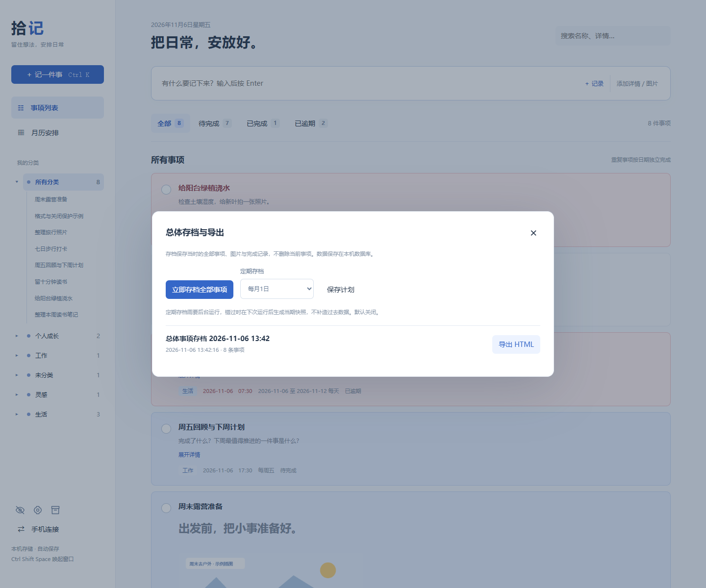

# 使用指南

## 新建与图文记录

快速输入名称，按 Enter 保存。点击「记一件事」或按 Ctrl+K 填写完整信息。正文支持文字和图片交替排列；点击「插入图片」、粘贴截图或拖入文件。每条最多 6 张，每张小于 2.8 MB。

选中文字后点击 **B** 或按 Ctrl+B 加粗；使用标题下拉设置正文／标题1／标题2／标题3。格式与图片顺序一起保存。

点击图片选中后可 Delete 删除，Ctrl+Z 撤销。双击图片放大；使用上一张／下一张或左右方向键切换当前事项内的图片。切换会恢复适应窗口，仍可点击 100% 或滚轮缩放。

## 分类和搜索

分类下拉显示已有类别，「＋ 新建」添加类别。类别独立保存，删除事项不会删除类别。

左侧「所有分类」默认展开全部可见事项名称。每个非空类别也可展开或收起；点击子项打开详情，点击类别文字筛选主列表。展开状态在当前页面的数据刷新期间保留。

搜索普通事项名称与正文；受保护事项只在授权显示期间匹配名称。状态按钮数量跟随分类与搜索变化。「待完成」包含逾期未完成事项。

## 日期、重复和提醒

| 规则         | 行为                                           |
| ------------ | ---------------------------------------------- |
| 指定某天     | 只在所选日期发生                               |
| 每天         | 从起始日每天发生，可选截止日                   |
| 每周         | 从起始日开始，在选中的多个星期发生，可选截止日 |
| 指定日期范围 | 从开始到结束每天发生，包含首尾两天             |

提醒需要勾选开关并设置时间。时间段在起止时刻分别提醒，跨天时间段需拆成两条。后台约每 15 秒检查一次。当天错过的提醒会在恢复运行时补发，历史日期不补发。

完成重复事项只影响所操作的那次日期。列表显示今天或下次发生日期；已结束的重复日程显示最后一次，历史各次状态在月历查看。

## 月历补记

点击日期格右上角「＋」或双击空白处新建。过去、今天、未来及格子内的相邻月份日期均可使用。选中日期后，顶部的新建和快速输入也采用该日期。

点击事项名称直接打开详情；日期数字或空白处显示当天列表。已完成为浅灰蓝底，未逾期待办为较深蓝底，逾期为浅红底，无删除线。

## 受保护事项

1. 点击齿轮图标，自行设置统一密码，至少 6 个字符。
2. 编辑事项时勾选受保护开关，默认关闭。
3. 眼睛图标默认关闭，此时列表、月历、分类子项均不显示受保护事项名称。
4. 输入密码开启显示，授权固定 15 分钟，浏览和刷新数据不续期。
5. 进入具体受保护详情再次验证密码。完成操作位于验证后的详情内。

授权只对当前窗口有效；刷新页面后恢复关闭。到期前一分钟提示保存，到期或提前关闭会关闭相关编辑区和图片查看器，锁定其中内容。未保存的受保护修改暂存在当前窗口的内存中，重新开启显示并验证后，可点击「恢复未保存内容」继续；刷新或退出会失去这份暂存。密码不能找回，本机数据及备份未加密。

类别名称本身可见，但只有开启显示时，其计数和名称子项才包含受保护事项。通用提醒不暴露受保护名称。

## 手机访问与停止

需要电脑开机运行且手机接入同一可信 Wi-Fi。源码版运行 `手机同步版.cmd`，Windows 下载版运行 `Start-LAN.cmd`。在「手机连接」查看地址与凭据。多个网卡可能显示多个 IP，请使用手机可访问的那个。

窗口关闭不等于后台退出。源码版运行 `python app.py --stop` 或 `关闭拾记后台.cmd`；下载版运行 `Stop-Shiji.cmd`。备份前务必先停止后台。

## 常见问题

**打不开或端口被占用？** 默认端口 8765。先停止旧实例；若被其他应用占用，使用 `--port 8770` 等空闲端口。不同数据目录的实例不要共用同一端口。

**提醒不出现？** 检查是否启用提醒、填了时间、该日期发生且未完成；电脑应保持开机、未睡眠且后台运行。没有开机自动启动功能。

**手机打不开？** 检查专用网络防火墙权限、同一 Wi-Fi、正确电脑 IP，以及路由器是否启用客户端隔离。不要使用公网端口映射。

**升级会丢记录吗？** 数据与程序分开保存。先停止和备份数据目录，再替换程序；不要覆盖或删除数据目录。

## 未保存修改与退出

点击详情右上角关闭或按 Esc 时，有修改会显示三个选项：保存并关闭、不保存、继续编辑。没有修改则直接关闭。格式、图片、日期、分类等修改都计入检查。

关闭或刷新浏览器／桌面窗口时，使用浏览器原生的离开确认；选择取消即可回到页面保存。仅关闭正文的图片查看器不会丢弃事项修改。外部强制结束进程、断电等场景无法弹出页面提示。

## 总体存档

点击侧栏存档盒图标：

1. 「立即存档全部事项」保存当前全部事项、图文格式、图片与完成记录的一份快照。
2. 「定期存档」可选择关闭、每周一或每月1日，点击保存计划。默认关闭，启用后从下个周期开始。
3. 点击「导出当前全部事项」，导出最新全部记录，包括已完成事项，不受当前页面筛选影响。有受保护事项时需验证密码后完整导出。
4. 点击「选择根目录」指定保存位置，然后「导出到目录」。根目录会被当前浏览器记住；目录名包含实际导出时间，重复导出新建目录。按事项分类新建子目录，每个事项各一份 HTML，图片内嵌，另有 `index.html` 总目录以及上一项／下一项导航。
5. 如浏览器不支持直接选择目录，点击「下载目录 ZIP」，解压到需要的位置。
6. 历史快照点击「导出此历史快照」，只导出当时的记录，不是最新全部事项。默认排除受保护事项，包含时需开启显示并验证密码。所有导出文件本身没有密码保护。

存档不删除当前事项，后续修改不会改变历史快照。后台必须运行才能定期生成；错过周期后在下次运行生成当期快照，不补造历史记录。快照保存在本机数据库且不自动清理，请同时做好整个数据目录的独立备份。

## 调整左侧栏宽度

把鼠标移到左侧分类栏与内容区之间，出现横向调整光标后，按住左键左右拖动。宽度会在当前浏览器中记住，刷新后恢复。双击分隔线恢复默认宽度。分隔线获得焦点时，左右方向键每次调整16像素，Home／End移到当前允许的最小／最大宽度。窗口缩小时自动限制宽度，保留主内容空间；手机窄屏使用原有布局。
